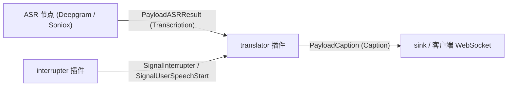
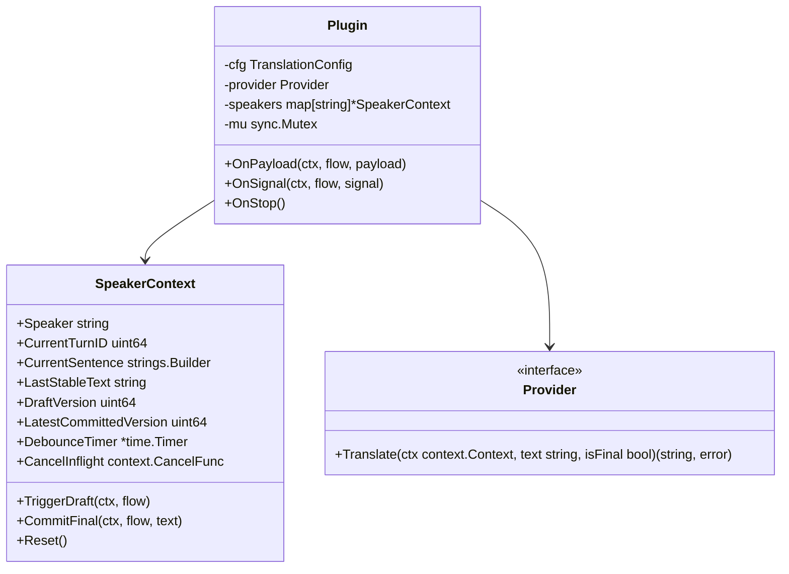
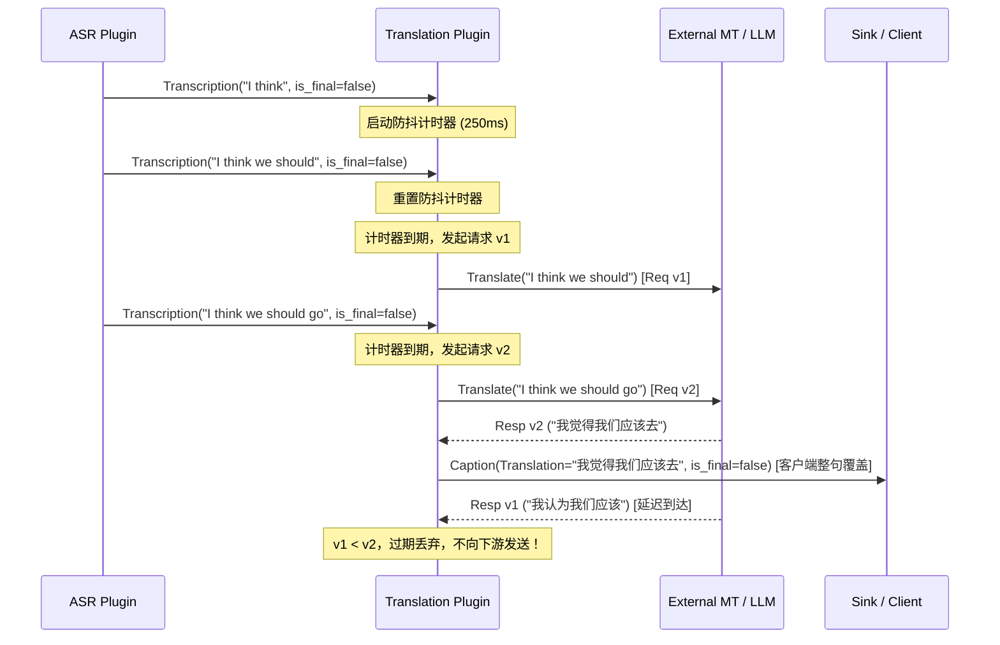

# 02 实时同传与双语字幕插件 (translator) 设计方案

---
创建时间: 2026-11-12T00:16:00+08:00
Base commit: 85c80420b671e1ed523fd128cb0d0c56962253d7
最后修改时间: 2026-11-12T00:16:00+08:00
创建人: ranchangxin
---

## 1. 背景与目标

### 1.1 业务背景
在实时语音交互与会议场景中，用户需要低延迟的双语实时字幕（Simultaneous Machine Translation, SimulMT / 同声传译）。
目前系统已有流式 ASR（Deepgram、Soniox、Qwen、Google）输出包含 `is_stable`、`is_final` 及 `speaker` 的识别结果，下游字幕插件（`caption`）负责分发。但在跨语种翻译时，存在核心挑战：
- **语序倒装与语法割裂**：不同语种语法结构差异显著（如英汉 SVO vs 日德 SOV、德语动词后置、英语从句倒置等）。若将 ASR 增量吐出的单词或小片段单独调用翻译后进行追加拼接，会导致语义严重失真与倒装混乱；
- **流式中间态高频开销**：ASR 每秒产生 10~20 次中间识别结果，若每包均触发网络翻译，不仅对外部 MT/LLM 服务造成高额 QPS 压力与费用开销，还会造成前端字幕高频闪烁；
- **网络异步乱序（Race Condition）**：短文本的后发请求可能因网络抖动早于先发请求返回，若缺乏版本控制，旧草稿覆盖新草稿会导致字幕回退倒退；
- **多说话人重叠与交叉**：在会议或双人对话场景中，不同 Speaker 的语音交替到来，翻译上下文与草稿不可相互混淆污染。

### 1.2 设计目标
1. **整句草稿覆盖模式（Sentence-level Draft-and-Revise）**：未断句前对活跃句子前缀进行局部重译，下游客户端进行整句原位替换；命中停顿或标点断句后进行确定性提交（Commit），避免词块拼接导致的语法混乱；
2. **多说话人状态完全隔离（Multi-Speaker Isolation）**：维护独立的说话人上下文，分别跟踪各自的草稿、定时器与版本号；
3. **防抖节流（Debounce / Throttle）**：对流式中间态实施可配置防抖窗口（默认 250ms），合并高频 ASR 推送，平滑字幕展示；
4. **版本化与乱序丢弃机制**：基于说话人及句维度的单调递增 `version_id`，丢弃网络慢请求导致的过期响应；
5. **打断信令响应（Barge-in / Interrupter）**：监听 `SignalInterrupter` / `SignalUserSpeechStart`，在打断发生时立即取消未完成网络请求并清除过期草稿；
6. **可插拔的翻译引擎适配（Provider Abstraction）**：首期支持 DeepL 极速翻译与 OpenAI 兼容格式 LLM 翻译，并提供 Mock Provider 满足脱机测试。

---

## 2. 总体架构与数据流

### 2.1 DAG 拓扑位置



### 2.2 核心内部组件



---

## 3. 详细设计

### 3.1 状态机与算法流程（Draft-and-Revise）

对于每一个到来的 ASR Payload（`schema.Transcription`）：

1. **说话人上下文路由**：根据 `payload.Speaker`（若为空默认为 `"default"`）获取或创建对应的 `SpeakerContext`；
2. **Turn 轮次检查**：若 `payload.TurnID > 0` 且不等于 `ctx.CurrentTurnID`，说明触发了新一轮对话，立即重置当前未提交草稿，更新 `ctx.CurrentTurnID = payload.TurnID`；
3. **断句与提交判定（Commit Gate）**：
   - 若 `payload.Final == true`（ASR VAD 端点判定用户停顿）：
     - 立即停止并重置正在等待的 `DebounceTimer`；
     - 取消当前正在处理的中间草稿 HTTP 请求（`CancelInflight()`）；
     - 将当前未提交的整句文本提交给 Provider，以 `isFinal = true` 执行最终翻译；
     - 发送 `schema.Caption{Text: text, Translation: trans, IsFinal: true, Speaker: speaker, Role: RoleUser}`；
     - 清空当前句子缓冲区与版本状态，准备迎接下一句；
   - 若命中强句末标点（`。！？.!?`）且长度达到断句阈值：
     - 同理执行断句提交，将标点前内容作为 `IsFinal: true` 固化下发，标点后残留文本留在缓冲区作为新句起始；
4. **流式草稿更新（Draft Update）**：
   - 若 `payload.Final == false`：
     - 将当前识别文本作为活跃草稿；
     - 启动或重置 `DebounceTimer`（例如 250ms）；
     - 定时器到期触发后，递增 `DraftVersion`，生成异步翻译任务；
     - 异步收到响应后，比较版本号：若响应版本 $\ge$ 该说话人最新版本，则调用 `flow.SendPayload(Caption{Text: text, Translation: trans, IsFinal: false})`；若已过期则直接丢弃。

### 3.2 乱序防护时序图



### 3.3 打断处理（Barge-in / Interruption）

当 `interrupter` 节点广播 `SignalInterrupter` 或 `SignalUserSpeechStart` 时：
- `translator` 插件的 `OnSignal` 捕获该信号；
- 提取信号携带的 `turn_id`（若有）；
- 立即遍历并取消所有正在发起的中间草稿异步请求，停止所有激活的 `DebounceTimer`；
- 防止在用户打断重讲时，由于上一轮的网络延迟导致上一轮的过时字幕突然跳出。

---

## 4. 接口与配置定义

### 4.1 配置结构体

```go
type TranslationConfig struct {
    Provider string `mapstructure:"provider" json:"provider"` // "deepl", "openai", "mock"
    
    SourceLanguage string `mapstructure:"source_language" json:"source_language"` // e.g. "en", "auto"
    TargetLanguage string `mapstructure:"target_language" json:"target_language"` // e.g. "zh"
    
    DebounceMs int `mapstructure:"debounce_ms" json:"debounce_ms"` // 默认 250ms
    
    // DeepL 配置项
    DeepLAuthKey string `mapstructure:"deepl_auth_key" json:"deepl_auth_key"`
    DeepLEndpoint string `mapstructure:"deepl_endpoint" json:"deepl_endpoint"` // 可选，默认官方 API
    
    // OpenAI / LLM 配置项
    LLMAPIKey   string `mapstructure:"llm_api_key" json:"llm_api_key"`
    LLMEndpoint string `mapstructure:"llm_endpoint" json:"llm_endpoint"`
    LLMModel    string `mapstructure:"llm_model" json:"llm_model"` // 如 "gpt-4o-mini"
}
```

### 4.2 节点契约（PluginMetadata）

- **名称**：`translator`
- **Inputs**：
  - `PayloadASRResult`: `text` (String, required), `is_final` (Boolean, required), `is_stable` (Boolean, optional), `speaker` (String, optional), `turn_id` (Integer, optional)
- **Outputs**：
  - `PayloadCaption`: `text` (String, required), `translation` (String, required), `is_final` (Boolean, required), `speaker` (String, optional), `role` (String, required), `turn_id` (Integer, optional)
- **Signals**：
  - 监听：`SignalInterrupter`, `SignalUserSpeechStart`

---

## 5. 实现阶段规划

1. **第一阶段：核心框架与状态机落地**
   - 建立 `internal/plugins/translator/` 目录结构；
   - 实现 `SpeakerContext` 状态管理、版本控制、防抖定时器与整句覆盖替换逻辑；
   - 编写 `MockProvider`，通过 `engine.NewPluginTester` 严格验证：中间帧覆盖、网络乱序丢弃、多 Speaker 隔离、断句 Commit 与打断清空。
2. **第二阶段：主流 Provider 接入**
   - 接入 DeepL API 与 OpenAI 兼容协议翻译 Provider；
   - 增加 HTTP 连接复用与超短请求超时控制（草稿 800ms，最终句 3s）；
   - 执行 `make generate` 注册插件。
3. **第三阶段：端到端与协同集成**
   - 与 `caption` 插件及前端 WebSocket/TUI 进行端到端联调测试；
   - 验证 Deepgram / Soniox -> translator -> caption -> Web 实时双语字幕展示。
