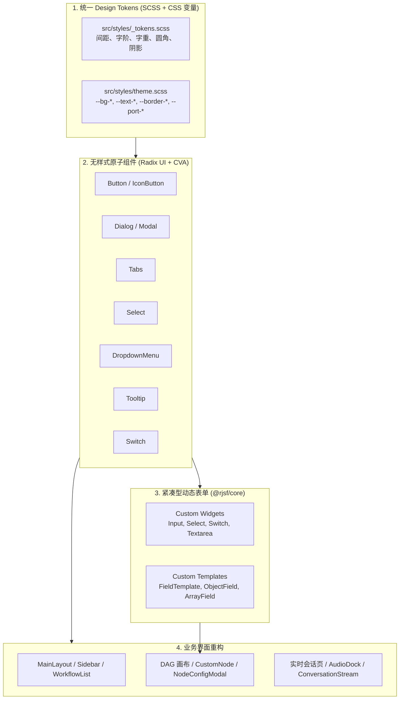

# Web UI 重构设计 (Tailwind v4 + shadcn/ui + SCSS Tokens)

---
创建时间: 2026-11-01T18:28:00+08:00
Base commit: 636252a19ac589c4cf0b002eeced49d01bc87fe6
最后修改时间: 2026-11-01T22:50:00+08:00
创建人: ranchangxin
状态: 已全量实施完成 (IDE 式 Studio 工作台与 Docked Playground 就绪)
---

## 1. 背景与问题定义

`clients/web` 目前使用 **MUI (v7) + Emotion + @rjsf/mui** 技术栈。在定位为实时语音交互与 DAG 编排引擎的 Voce 项目中，暴露出以下问题：

1. **视觉风格错位**：MUI 带有强烈的传统 Material Design（大圆角投影、浮动标签、水波纹、低信息密度），与现代 AI 工作流工具（如 Linear, Raycast, Dify, Langflow, Vercel）的“高密度、1px 细边框、极简磨砂”审美存在代差。
2. **包体积严重膨胀**：目前 `EditorPage` 生产单 chunk 达到 **1,083 kB**（Gzip 后仍达 344 kB），其中大部分为 MUI、Emotion 运行时 CSS-in-JS 以及 `@rjsf/mui` 的冗余样式代码。
3. **动态表单与节点抽屉松散**：节点配置依赖 `@rjsf/mui` 自动渲染，输入项间距过大、标签膨胀，无法适应高密度的 DAG 拓扑参数调优。
4. **设计规范分散**：全局虽然有 `src/theme/tokens.ts`，但与 MUI 主题覆写、局部硬编码 sx/style 杂糅，未形成严格可推导的统一设计标尺。

本设计提出彻底移除 `@mui/*` 与 `@emotion/*`，基于 **Tailwind CSS v4 + Radix UI (shadcn/ui 体系)**，构建统一的 **SCSS Design Tokens** 系统，并使用 `@rjsf/core` 自研紧凑型动态表单模板。

---

## 2. 目标与非目标

### 2.1 目标
- **视觉现代化与风格一致性**：建立统一的 Design Tokens（基于 4px 网格的 SCSS 变量 + CSS 语义变量），全站共享相同的间距、字号阶梯、圆角、阴影与配色系统（深浅色双模式无缝切换）。
- **紧凑型自研动态表单**：基于 `@rjsf/core` 打造一套轻量、高信息密度的自研表单部件（替换 `@rjsf/mui`），完美适配 JSON Schema。
- **现代化 DAG 节点外观**：重构 ReactFlow `CustomNode`，采用深色玻璃卡片质感、精细端口（Port）微光、紧凑属性标签与清晰连接线。
- **性能与体积大幅优化**：彻底清理 Emotion 运行时开销，`EditorPage` 分包体积降低 50% 以上（目标 < 500 kB）。
- **底层实时逻辑与契约零回归**：保持 Web Audio DSP 链路（FIR 重采样、环形缓冲、AEC 兼容）、私有二进制 VC 封包编解码、会话状态机和 DAG 连线验证 100% 不变。

### 2.2 非目标
- 不重构 ReactFlow 画布底层状态（保持现有 `nodes/edges` 状态模型与 `validation.ts` 契约校验）。
- 不调整 Go 后端静态文件挂载路径（保持构建产物输出至 `clients/web/dist`，继续兼容 `clients/assets.go` 的 `//go:embed`）。
- 不引入外部庞大的三方商业组件库，所有原子组件基于 Radix UI 无样式基建自建在 `src/components/ui/` 下。

---

## 3. 总体架构设计



---

## 4. 统一 Theme 与 SCSS 变量设计

所有设计规范收敛于 `src/styles/_tokens.scss`，并通过 CSS 自定义属性承接运行时主题切换。

### 4.1 SCSS 变量标尺规范 (`src/styles/_tokens.scss`)

```scss
// 1. 间距系统 (4px 基础网格)
$space-0: 0px;
$space-0-5: 2px;
$space-1: 4px;
$space-1-5: 6px;
$space-2: 8px;
$space-2-5: 10px;
$space-3: 12px;
$space-4: 16px;
$space-5: 20px;
$space-6: 24px;
$space-8: 32px;
$space-10: 40px;
$space-12: 48px;

// 2. 紧凑型排版阶梯 (高密度工具设计)
$font-3xs: 9px;
$font-2xs: 10px;
$font-xs: 11px;
$font-sm: 12px;
$font-base: 13px; // 正文字号基准 (Linear / Raycast 规范)
$font-md: 14px;
$font-lg: 16px;
$font-xl: 18px;
$font-2xl: 22px;

// 3. 字重
$font-weight-normal: 400;
$font-weight-medium: 500;
$font-weight-semibold: 600;
$font-weight-bold: 700;

// 4. 圆角标尺
$radius-xs: 4px;
$radius-sm: 6px;
$radius-md: 8px;
$radius-lg: 12px;
$radius-xl: 16px;
$radius-full: 9999px;

// 5. 字体族
$font-sans: 'Inter', -apple-system, BlinkMacSystemFont, 'Segoe UI', Roboto, sans-serif;
$font-mono: 'JetBrains Mono', 'Fira Code', ui-monospace, Menlo, Consolas, monospace;
```

### 4.2 语义化颜色与主题变量 (`src/styles/tokens.scss` 与 `src/index.css`)

在 Tailwind v4 环境下，通过 `@custom-variant dark (&:where(.dark, .dark *));` 保证 CSS 变量与暗黑类无缝联动：

```scss
:root {
  // 浅色主题 (Apple System 灰白风格)
  --bg-app: #f4f4f6;
  --bg-panel: #ffffff;
  --bg-card: #ffffff;
  --bg-sunken: #f0f0f3;
  --bg-chat: #fbfbfd;
  --bg-chat-bubble: #ffffff;
  
  --text-primary: #18181b;
  --text-secondary: #71717a;
  --text-muted: #a1a1aa;
  
  --border-subtle: rgba(0, 0, 0, 0.08);
  --border-strong: rgba(0, 0, 0, 0.16);
  --border-focus: #007aff;
  
  --primary: #007aff;
  --primary-foreground: #ffffff;
  --primary-hover: #0066d6;
  
  --signal-ok: #16a34a;
  --signal-warn: #ea580c;
  --signal-danger: #dc2626;
  
  // 端口类型专用色
  --port-signal: #3b82f6;   // Blue
  --port-payload: #8b5cf6;  // Purple
  --port-audio: #10b981;    // Emerald
  --port-video: #f59e0b;    // Amber
}

.dark {
  // 深色主题 (Zinc / 极简暗黑风格)
  --bg-app: #09090b;       // DAG 纯黑画布底色
  --bg-panel: #1e1e2c;     // 侧栏与浮动抽屉底色
  --bg-card: #222232;      // 卡片与右侧面板底色
  --bg-card-hover: #2c2c3e;
  --bg-sunken: #161622;    // 下凹输入框/凹槽底色
  --bg-chat: #1c1c2a;      // 语音会话流专属底色（与纯黑画布形成清晰对比）
  --bg-chat-bubble: #28283a; // 助手气泡底色
  
  --text-primary: #f4f4f5;
  --text-secondary: #a1a1aa;
  --text-muted: #71717a;
  
  --border-subtle: rgba(255, 255, 255, 0.1);
  --border-strong: rgba(255, 255, 255, 0.2);
  --border-focus: #0a84ff;
  
  --primary: #0a84ff;
  --primary-foreground: #ffffff;
  --primary-hover: #0070e0;
  
  --signal-ok: #22c55e;
  --signal-warn: #f97316;
  --signal-danger: #ef4444;
}
```

---

## 5. 自定义动态表单系统 (@rjsf/core)

彻底淘汰 `@rjsf/mui`，在 `src/components/Form/` 下基于 `@rjsf/core` 自研全套紧凑模板与小部件：

1. **`CompactFieldTemplate`**：
   - 顶部 11px 胶囊标签展示字段名，必填项带有红星号 `*`。
   - 悬浮说明通过 `Tooltip` 气泡展示，避免大段描述文字破坏界面紧凑性。
   - 底部以 11px 红色警示文本呈现校验报错。
2. **`CompactInputWidget` & `CompactTextareaWidget`**：
   - 1px 微边框、聚焦微光、Monospace 代码字体（针对数值、变量名及 JSON 片段）。
3. **`CompactSelectWidget`**：
   - 基于 `@radix-ui/react-select` 封装，支持暗黑模式弹层与键盘首字母导航。
4. **`CompactCheckboxWidget`**：
   - 采用精致的小巧拨动开关（Switch）代替粗糙的 Checkbox。
5. **`CompactObjectFieldTemplate` & `CompactArrayFieldTemplate`**：
   - 嵌套对象采用紧凑边框卡片收纳，数组列表提供精巧的“添加行”和行末垃圾桶删除图标。

---

## 6. 各模块重构细则 (IDE 式 Studio 架构)

### 6.1 统一 Studio 布局体系 (`StudioLayout`, `StudioActivityBar`, `StudioLeftRail`)
- **Activity Bar (48px)**：VS Code 式极简图标栏，纯粹承载 `Workflows` 与 `Nodes` 视图切换；彻底移除顶底冗余图标，保持聚焦。
- **Left Rail 抽屉**：支持无级边缘拖拽（200px ~ 480px），内置两种交互模式：
  - **Pinned 固定模式**：以 flex 布局推移 DAG 画布；
  - **Overlay 抽屉模式**：滑出覆盖在画布上方，零画布抖动与位移，双击把手恢复默认宽度。

### 6.2 顶栏与核心视图分段控制 (`StudioHeader`)
- **品牌与标题**：48px 极细边框顶栏，品牌 Logo 起步，支持工作流名称双击/点击图标原地无感重命名与保存状态提示。
- **右侧分段控制器 (Segmented Switcher)**：
  - 统一集成 `[ 📋 Inspector ]`、`[ 🎙️ Playground ]`、`[ 📈 Monitor ]` 三合一视图切换器；
  - 配备单键侧栏收起/展开 `[ ◨ ]` 与主题切换按钮。

### 6.3 右侧 Dock 面板集群 (`StudioInspector`, `StudioPlayground`, `StudioMonitor`)
淘汰过去散落的多层浮窗与模态弹窗，收敛为统一的可拖拽调宽（280px ~ 640px）右侧 Dock 容器：
1. **`StudioInspector` (属性与配置)**：
   - 画布点击任意节点时自动切换切入；
   - 集成自研紧凑表单（@rjsf）与 CodeMirror 6 JSON 原始视图切换；支持 Head 入口节点设置与连线规则提示。
2. **`StudioPlayground` (实时语音交互测试)**：
   - 全功能集成麦克风/扬声器设备选择、实时音频电平、连接状态机胶囊；
   - **参数覆盖 (Properties Overrides)**：内置 CodeMirror JSON 编辑器，支持「节点模板」一键提取拓扑生成参数结构，发起时 deep-merge 到节点配置；
   - **视觉层次优化**：采用专属 `--bg-chat` 与 `--bg-chat-bubble`，与纯黑 DAG 画布（`#09090b`）形成明确的层次分界。
3. **`StudioMonitor` (运行时监控与遥测)**：
   - 实时音频下行波形分析仪、服务端 VAD 状态、分阶段轮次延迟瀑布图（ASR / LLM 首字 / TTS 首包）与调度指标。

### 6.4 DAG 画布与自定义节点 (`WorkflowPage`, `CustomNode`)
- **节点外观**：重构为 260px 宽度的深色卡片（`bg-card/90 backdrop-blur border border-border-subtle rounded-xl`）。
- **Head 节点标注**：金色微发光王冠徽章，卡片顶部带微光亮条。
- **端口设计**：四色圆点 Handles，悬停展开包含契约字段类型列表的浮动气泡，边拖拽时提供动态校验反馈。

---

## 7. 依赖调整计划

### 移除的包
- `@mui/material`
- `@mui/icons-material`
- `@emotion/react`
- `@emotion/styled`
- `@rjsf/mui`

### 新增/保留的核心包
- `tailwindcss` (v4) 与 `@tailwindcss/vite`
- `sass`（已添加）
- `@radix-ui/react-dialog`
- `@radix-ui/react-dropdown-menu`
- `@radix-ui/react-tabs`
- `@radix-ui/react-tooltip`
- `@radix-ui/react-switch`
- `@radix-ui/react-select`
- `@rjsf/core` 与 `@rjsf/validator-ajv8`（保留）
- `lucide-react`、`clsx`、`tailwind-merge`（保留）
- `@uiw/react-codemirror` 与 `@codemirror/lang-json`（用于配置与覆盖参数编辑）

---

## 8. 分阶段实施路线与状态

- [x] **Phase 1: 基础设施**（Tailwind v4 配置、SCSS Tokens 建立、CSS 语义变量接入）
- [x] **Phase 2: 原子 UI 组件库**（Button, Dialog, Tabs, Select, Switch, Dropdown, Tooltip, Input, Badge）
- [x] **Phase 3: @rjsf/core 自研紧凑表单系统**（Widgets, Templates, 动态表单联动）
- [x] **Phase 4: DAG 画布与节点精细化**（CustomNode 卡片质感、四色端口、连线动态校验）
- [x] **Phase 5: 依赖彻底清理**（完全移除 MUI/Emotion，分包构建体积降至 ~450 kB Gzip）
- [x] **Phase 6: IDE 式 Studio 工作台整合**（Activity Bar、可调宽双侧栏、顶部 Segmented Switcher）
- [x] **Phase 7: Voice Playground Dock 升级**（内置参数覆盖 CodeMirror 编辑器、会话专属底色、空状态与气泡优化）
