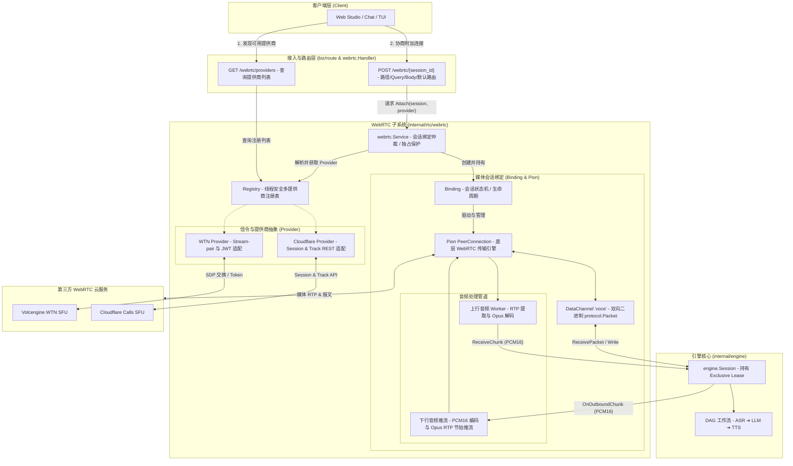

# WebRTC 接入设计

---
创建时间: 2026-11-11T15:20:00+08:00
Base commit: 43418f178891a192285f864b4892e37d53ab6a1a
最后修改时间: 2026-11-11T15:24:00+08:00
创建人: ranchangxin
状态: 已实现（仅 standalone）
---

本文档定义 Voce 中 WebRTC 传输层的完整设计与实现规范。WebRTC 在 Voce 中用于提供比传统 WebSocket 更低延迟、更抗网络抖动的端到端实时语音交互体验。

---

## 1. 目标与边界

### 1.1 核心目标

一个已创建的会话（`Session`）可通过 WebRTC 接入 Voce 的 DAG 实时语音流水线：

- **双向音频通道**：客户端麦克风上行音频（Opus RTP）解码输入到 ASR 节点；服务端生成的 TTS 下行音频编码后推向客户端播放。
- **全双工控制通道**：文本消息、LLM 流式字幕、打断信号（Interruption）与会话生命周期控制通过 WebRTC DataChannel（`voce`）传输，报文格式与现有 WebSocket 二进制协议完全一致。
- **统一信令与多云 SFU 调度**：底层媒体引擎由 Pion 统一驱动；上层信令抽象为可插拔的 `Provider` 接口，支持动态注册多个 WebRTC 云厂商（如火山引擎 WTN、Cloudflare Calls），并支持客户端按需路由。
- **零拷贝与低延迟分配**：复用内存缓冲池（`buf.ChunkPool`），音频转码与收发协程生命周期严格受控，无内存泄漏与数据竞争。

### 1.2 明确非目标

- **不涉及多人音视频会议**：采用一对一专用音频交互链路（一个客户端对应一个服务端 Agent 实例）。
- **不涉及视频/屏幕共享**：当前核心聚焦在极低延迟语音链路（ASR -> LLM -> TTS）。
- **Gateway 暂不代理该端点**：WebRTC Attach 端点目前仅在 standalone 单机模式下装配与生效。

---

## 2. 总体架构与模块划分



### 2.1 模块职责分工

| 文件/目录 | 核心职责 |
| :--- | :--- |
| `internal/rtc/webrtc/provider.go` | 定义 `Provider` 接口（`Name()` 路由主键与 `Metadata()` 展示元数据）及中立的协商数据结构。 |
| `internal/rtc/webrtc/registry.go` | 线程安全的提供商注册表，管理已启用的提供商列表、排序与默认提供商。 |
| `internal/rtc/webrtc/service.go` | 管理 SessionKey 到 `Binding` 的映射、提供商解析路由、服务全局状态与会话销毁观察者。 |
| `internal/rtc/webrtc/binding.go` | 单会话 PeerConnection 封装：管理 DataChannel 消息收发、下行音频队列推流与连接状态机。 |
| `internal/rtc/webrtc/worker.go` | 音频上行解耦协程：`readLoop` 负责 RTP 帧提取，`decodeLoop` 负责 Opus 解码，基于 Context 控制生命周期并排空回收内存。 |
| `internal/rtc/webrtc/handler.go` | HTTP 端点解析：处理 `GET /webrtc/providers` 发现及 `POST /webrtc/{id}` 的多途径 Provider 路由。 |
| `internal/rtc/webrtc/media/` | 基于 Pion 的底层音视频 PeerConnection 工厂与通用 ICE 配置定义。 |
| `providers/wtn/` | 火山引擎 WTN 适配器：实现基于 Stream-pair 模型的 JWT 签发与 REST 协商。 |
| `providers/cloudflare/` | Cloudflare Calls 适配器：实现基于 Session 与 Track 的 Calls REST API 双向协商。 |

### 2.2 架构边界要求

- **`engine` 零侵入**：`engine` 内部只认 `Session.ReceiveChunk`、`Session.OnOutboundChunk` 与 `session.ReceivePacket`，不感知任何 WebRTC / SFU 概念。
- **媒体与信令完全解耦**：Pion 负责底层 RTP 收发与媒体协议；`Provider` 仅负责向远端云平台提交本地 Offer SDP 并取得 Answer SDP 与客户端鉴权凭证。

---

## 3. 多 Provider 注册与路由分发

### 3.1 稳定的 Provider 接口契约

为了防止未来前端展示需求（如图标、支持特性、文档链接）改动导致 Go 接口签名频繁破坏，将核心运行时主键与描述性元数据拆分：

```go
type Metadata struct {
	Label       string `json:"label"`
	Description string `json:"description,omitempty"`
}

type Provider interface {
	// Name 返回唯一的 Provider 标识（如 "wtn", "cloudflare"），作为路由和配置的主键
	Name() string

	// Metadata 返回该 Provider 的描述性元数据
	Metadata() Metadata

	// Negotiate 向 SFU 提交本地 Offer SDP，获取 Answer SDP、资源句柄和客户端凭证
	Negotiate(ctx context.Context, request NegotiateRequest) (*NegotiateResult, error)

	// ICEServers 返回当前 Provider 所需的 STUN/TURN 服务器配置
	ICEServers(ctx context.Context, sessionKey protocol.SessionKey) ([]media.ICEConfig, error)

	// Teardown 清理远端会话或媒体轨道资源
	Teardown(ctx context.Context, handle string) error
}
```

### 3.2 动态注册表 (Registry)

- **注册**：调用 `registry.Register(p Provider)`，首个注册成功的 Provider 自动成为默认项（`defaultName`）。
- **默认覆盖**：可通过配置文件顶层 `webrtc.default` 显式设置默认 Provider。
- **查询与列表**：`registry.Get(name)` 按名称获取对应 Provider，若传入空字符串则返回默认 Provider；`registry.List()` 按注册顺序返回全部实例。

### 3.3 路由协商与服务发现

系统对外暴露统一的 HTTP 协议，支持客户端动态发现并按需选路：

1. **服务发现端点 (`GET /webrtc/providers`)**：
   ```json
   {
     "code": 200,
     "message": "ok",
     "data": {
       "default": "wtn",
       "providers": [
         { "name": "wtn", "label": "Volcengine WTN", "description": "火山引擎 WebRTC 传输网络" },
         { "name": "cloudflare", "label": "Cloudflare Calls", "description": "Cloudflare 全球 Anycast 边缘 WebRTC" }
       ]
     }
   }
   ```
2. **协商端点 (`POST /webrtc/{session_id}`)**：
   按以下优先级选定 Provider：
   - 路径参数：`POST /webrtc/{session_id}/{provider}`
   - Query 参数：`POST /webrtc/{session_id}?provider=cloudflare`
   - JSON 请求体：`POST /webrtc/{session_id}`，Body `{"provider": "cloudflare"}`
   - 缺省回退：使用 `webrtc.default` 配置的默认 Provider。

---

## 4. 提供商实现规范

### 4.1 火山引擎 WTN (`providers/wtn`)

- **通信模型**：Stream-pair 模型。每个客户端与服务端配对绑定两个 Stream ID（推流流与拉流流）。
- **信令协商**：服务端使用 AppID + AppKey 本地生成 HS256 JWT Token，调用 WTN REST 端点 `/webrtc/pub-sub/{app_id}/{pub_id}/{sub_id}` 完成 SDP 交换。
- **凭证结构**：向客户端下发 `app_id`、`token`、`pub_stream_id`、`sub_stream_id` 以及 STUN 服务器列表。

### 4.2 Cloudflare Calls (`providers/cloudflare`)

- **通信模型**：SFU Session + Track 模型。
- **信令协商**：
  1. 服务端调用 `POST /v1/apps/{app_id}/sessions/new` 创建远端 PeerConnection 上下文。
  2. 生成服务端本地 Opus 音频 Offer SDP，调用 `POST /v1/apps/{app_id}/sessions/{session_id}/tracks/new` 发布音频轨，得到 Answer SDP 与 `track_name`。
- **清理机制**：会话关闭时调用 `PUT /v1/apps/{app_id}/sessions/{session_id}/tracks/close` 回收云端音轨。
- **客户端两阶段协商**：客户端通过 Cloudflare Calls REST API 先提交上行音频轨，再拉取服务端的下行音频轨，无需预先创建配对 Stream ID。

---

## 5. 生命周期与资源所有权

### 5.1 独占租约 (Lease) 与并发互斥

与 WebSocket / gRPC 保持严格一致：
1. 客户端发起 `Attach` 时，首先尝试获取会话独占租约 `session.Bind()`。若该 Session 当前已有活跃连接，返回 `409 Conflict`。
2. 同一连接如果在断线宽限期内重复发起相同 `Attach`，幂等返回已缓存的凭证。
3. `Binding` 持有 Session Lease，连接销毁时主动执行 `session.Unbind()`。

### 5.2 状态转换与断网处理

- **连接建立**：Pion PeerConnection 协商成功后进入 `Connected` 状态，触发 `session.Activate()` 激活 DAG Workflow。
- **网络中断**：检测到 ICE 状态变为 `Disconnected` 时，自动将 Workflow 置为 `Paused`，等待客户端短时间内的网络恢复。
- **连接关闭或超时**：进入 `Failed` 或 `Closed` 状态时，关闭音轨协程，释放 PeerConnection，并调用 `Provider.Teardown` 清理 SFU 资源。
- **会话销毁感知**：通过 `SessionManager.AddDeletedObserver` 注册观察者，一旦底层 Workflow 被主动删除或超时回收，即刻异步销毁媒体连接。

---

## 6. 数据路径与并发优化

### 6.1 上行音频处理 (Inbound Audio)

上行链路必须同时保证低延迟与内存安全：

```text
TrackRemote (Opus RTP)
      │
      ▼
readLoop ──> samples chan (*buf.Buffer) ──> decodeLoop ──> 16kHz PCM16 ──> session.ReceiveChunk
```

1. **双协程并行**：
   - `readLoop`：高频从 RTP 音频包中提取负载字节写入 `samples` channel。
   - `decodeLoop`：从 `samples` channel 消费音频包，调用 Opus 解码器转为 16000Hz、单声道、PCM16 帧，提交给会话管道。
2. **生命周期与排空回收**：
   - 派生独立的 `workerCtx`。一旦读取结束或发生错误，`defer cancel()` 会立刻通知 `decodeLoop` 退出。
   - `decodeLoop` 在退出前以非阻塞方式彻底排空 `samples` channel 中的残留数据，将所有由 `ChunkPool` 分配的 Buffer 安全 `Release()` 归还内存池。

### 6.2 下行音频处理 (Outbound Audio)

- 服务端 TTS 节点生成的 PCM16 音频帧通过 `session.OnOutboundChunk` 投递到 `Binding` 的出站缓冲队列。
- 使用独立的下行工作协程，按 20ms 节拍进行 Opus 编码打包，写入 Pion `TrackLocalStaticSample` 推送给 SFU。

### 6.3 控制信令 (DataChannel)

- 服务端创建名为 `voce` 的可靠传输 DataChannel。
- 所有非音频 Packet（文本消息、LLM 打字机输出、打断事件、Ping/Pong）均打包为统一的二进制 `protocol.Packet` 编码格式。
- 保证应用层无论走 WebSocket 还是走 WebRTC，所见到的业务数据结构 100% 对齐。

---

## 7. 前端交互设计

在 Studio Playground 抽屉与 Chat 配置侧栏中，为了保障开发调试效率与界面空间紧凑性，前端采用**扁平化单层通道选择器（Flat Tabs）**：

1. **动态展开通道**：
   - 单 Provider 时：`[ WebSocket ]` `[ WebRTC ]`
   - 多 Provider 时：`[ WebSocket ]` `[ WTN ]` `[ Cloudflare ]`
2. **零高度跳动 (No Layout Shift)**：
   - 无论后台启用了一个还是多个 WebRTC 服务商，选择器始终占据单行高度（`h-7` / `28px`），下方电平表与音量控制控件完全不发生垂直跳动。
3. **悬浮提示**：
   - 鼠标悬停显示完整标签与厂商特性（如 `Volcengine WTN - 火山引擎 WebRTC 传输网络`）。

---

## 8. 配置示例

在 `config/bootstrap.go` 中声明 `WebRTCConfig`：

```yaml
webrtc:
  default: "wtn" # 默认使用的提供商名称："wtn" 或 "cloudflare"
  wtn:
    app_id: "your-wtn-app-id"
    app_key: "your-wtn-app-key"
    base_url: "https://wtn.volcvideo.com"
    stuns:
      - "stun:stun.volcengine.com:3478"
    token_expire: 24h
    stream_prefix: "voce-"
  cloudflare:
    app_id: "your-cloudflare-calls-app-id"
    app_secret: "your-cloudflare-calls-app-secret"
    base_url: "https://rtc.live.cloudflare.com/v1/apps"
    stuns:
      - "stun:stun.cloudflare.com:3478"
    timeout: 10s
```
